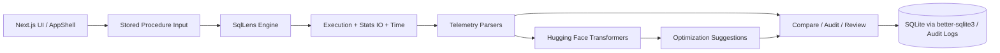
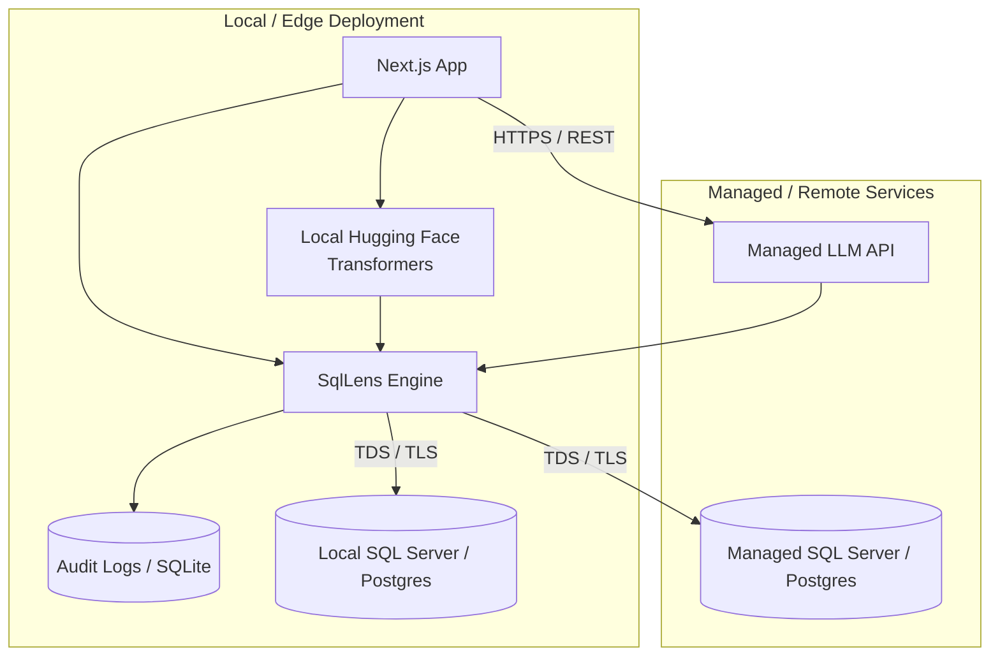

# SQLLens

SQLLens is an AI-assisted SQL stored procedure analysis and optimization platform designed to ingest stored procedures, execute them against SQL Server or PostgreSQL, capture execution telemetry, analyze IO and timing metrics, and propose optimization recommendations with LLM-backed reviews. The project combines a Next.js application shell, a local execution engine, telemetry parsers, and model management workflows for review, comparison, and auditing.

## Getting Started

Start the development server from the repository root:

```bash
npm run dev
```

Open [http://localhost:3000](http://localhost:3000) with your browser to see the result.

## Architecture Overview

SqlLens is built as a layered system that separates end-user workflows from execution and analysis components. The architecture is deliberately split between a web application layer, a SQL execution engine, telemetry parsers, and a Hugging Face Transformers-powered optimization layer.

### System Components

- SqlLens Engine: Executes stored procedures in local simulation mode or via real database drivers for SQL Server (`mssql`) and PostgreSQL (`pg`), and records execution statistics and audit logs.
- LLM Layer: Runs ONNX text-generation models in-process on the Next.js server with Transformers.js (`@huggingface/transformers` 4.2.0) to review stored procedures based on captured telemetry, query patterns, and IO anomalies. The Python `transformers` library is not used by the app; the Python script `scripts/validate_and_download_model.py` only downloads and validates model files.
- SQL Server / PostgreSQL: Source systems where stored procedures run, producing `STATISTICS IO`, `STATISTICS TIME`, and execution plans.
- Telemetry Parsers: Normalize raw SQL engine output into structured metrics such as logical reads, physical reads, scan counts, CPU time, elapsed time, and hot tables.
- Audit Log Store: Persists execution records to the `audit_requests` SQLite table and writes a text copy of each run to `audit_logs/`, supporting later comparison and review.

### Core Data Flow

1. SP Extraction: A stored procedure definition is entered via the app UI or API.
2. Execution + Stats Capture: The engine executes the SP in simulation or live mode and gathers raw IO / time output.
3. Telemetry Normalization: Parsers convert raw outputs into machine-readable performance metrics.
4. Comparative Analysis: The original and optimized SPs are compared using logical reads, scan counts, and elapsed time.
5. LLM Optimization: The Transformers-based LLM layer reviews the procedure and suggests index, query, or rewrite improvements.
6. Upsert / Persistence: The results, comparison summaries, and audit metadata are stored for later inspection and recommendation tracking.



## Network Topology & Deployment Diagram

SqlLens supports a flexible deployment model spanning local edge execution and remote managed services, with a local Hugging Face Transformers inference path as the primary AI layer.

### Deployment Boundaries

- Local / Edge deployment:
  - Next.js app runs locally on developer machines or a private edge node.
  - Hugging Face Transformers executes locally in-process or through a privately hosted local inference service.
  - SQLite or local audit storage can persist execution metadata and application state.
  - SQL connectivity remains inside the private trust boundary when connecting to local SQL Server or PostgreSQL instances.

- Remote / Managed deployment:
  - Managed SQL Server or PostgreSQL instances can be accessed over the network.
  - Remote model endpoints or managed AI APIs may be used if configured for cloud inference.
  - Cloud-hosted telemetry, review services, or shared model backends may be used if the deployment requires them.

### Protocol and Port Reference

| Component | Network Path | Typical Port / Protocol | Purpose |
| --- | --- | --- | --- |
| Web App UI | HTTP / HTTPS | 3000 | User interface and operational dashboard |
| SQL Server | TDS / TLS | 1433 | SQL Server connections |
| PostgreSQL | PostgreSQL wire protocol | 5432 | PostgreSQL connectivity |
| Local Transformers Runtime | In-process / local REST bridge if enabled | 8000 or local IPC | Local model inference within the same trust boundary |
| Managed LLM API | HTTPS / REST | 443 | Remote model provider access |
| Audit Log / Local Storage | File system / local IPC | N/A | Persistence of stored results |



### Security and Data-in-Transit Boundaries

- SQL connectivity is typically carried over TDS/TLS for SQL Server and encrypted client traffic for PostgreSQL where configured.
- Local Hugging Face Transformers inference remains inside the local trust boundary unless an explicit local REST bridge is exposed externally.
- Managed API traffic crosses a cloud boundary and should use TLS and secret management (API keys, environment variables, or secure secret stores).
- Audit logs and execution outputs should be treated as sensitive operational data and protected according to database and application policy.

## Changelog Summary

- Updated the Architecture Overview to reflect the Hugging Face Transformers-based AI layer instead of a generic LLM abstraction.
- Kept the local/edge vs. managed deployment model while clarifying the local trust boundary for Transformers-based inference.
- Revised the deployment diagram and port reference to emphasize local Transformers execution and optional local REST bridging.

## Roadmap

The roadmap, current status, and prioritized backlog are in [docs/ROADMAP.md](docs/ROADMAP.md).

## Download and Validate Transformer Models

The `scripts/validate_and_download_model.py` script downloads a Hugging Face model, mirrors its repository structure, validates required files, computes SHA-256 checksums, and only finalizes the model after successful validation.

### Usage

```bash
# run from the repository root (the directory that contains package.json)
python3 scripts/validate_and_download_model.py \
  onnx-community/Qwen2.5-0.5B-Instruct-ONNX
```


For a private Hugging Face repository:

```bash
HF_TOKEN=hf_your_token python3 scripts/validate_and_download_model.py owner/model
```

The script also accepts the token from the `HF_TOKEN` environment variable.

### Validation stages

1. Read repository metadata and detect the model architecture.
2. Download all repository files while preserving nested directories.
3. Validate configuration, tokenizer, and model weight files.
4. Compute SHA-256 checksums and compare available manifests.
5. Write validation metadata and finalize the model directory.

Incomplete or invalid downloads are removed automatically.

### Output

Validated models are stored under:

```text
downloads/models/<owner>_<model>/
├── config.json
├── tokenizer.json
├── tokenizer_config.json
├── onnx/
├── checksums.json
└── sqlens-model.json
```

The `sqlens-model.json` file contains the model ID, source URL, detected architecture, and validation status.

### Requirements

A model must contain:

- `config.json`
- At least one supported weight file:
  - `.safetensors`
  - `.bin`
  - `.pt`
  - `.pth`
  - `.onnx`
- At least one tokenizer asset:
  - `tokenizer.json`
  - `tokenizer.model`
  - `vocab.json`
  - `spiece.model`

For the local Transformers.js inference route, the model must additionally contain compatible ONNX weights, such as:

```text
onnx/model_quantized.onnx
```

Original Hugging Face repositories containing only `.safetensors` files are valid Transformer repositories but cannot be executed by the current ONNX-based Transformers.js route.

### Failure behavior

If required files are missing, files are empty, checksums do not match, or the repository cannot be downloaded, the script exits with status `1` and removes the temporary download.

## Documentation

- [Developer Guide](docs/developer_guide.md)
- [Architecture](docs/architecture.md)
- [API Reference](docs/api.md)
- [Configuration](docs/configuration.md)
- [Model Management](docs/model-management.md)
- [Prompting](docs/prompting.md)
- [Troubleshooting](docs/troubleshooting.md)
- [Contributing](docs/contributing.md)
- [Changelog](docs/changelog.md)
